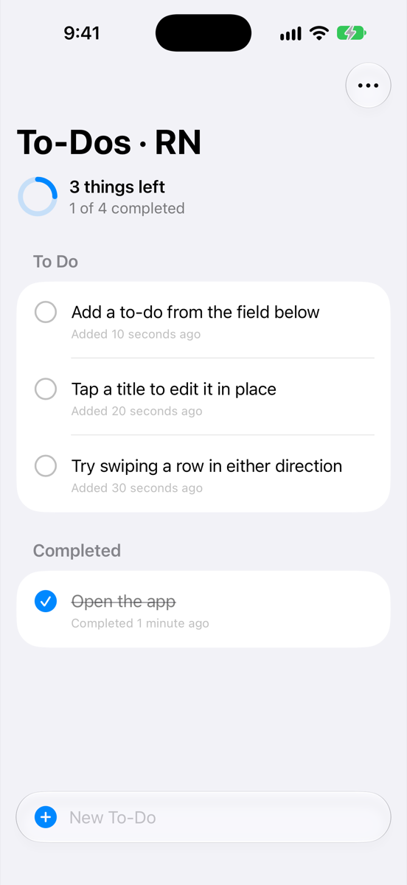
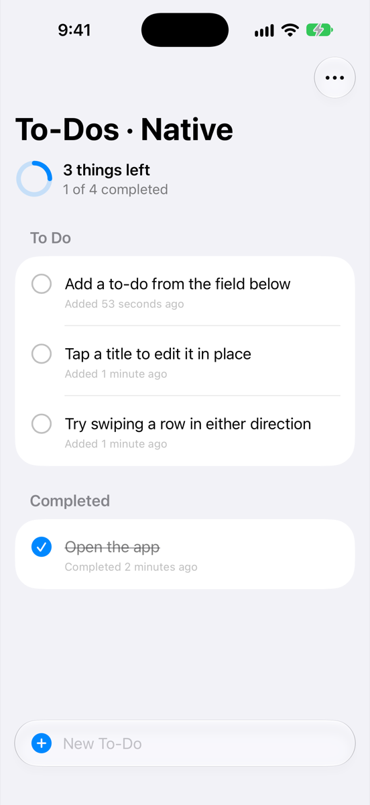

# native-todo

A proof of concept: **a fully native SwiftUI app that doesn't depend on React
Native at all, shipped inside a React Native (Expo) entrypoint.**

React Native's only job here is to boot and mount one native view. Everything
the user sees and touches (UI, navigation, state, persistence) is SwiftUI and
SwiftData. Because the app code never imports React Native or Expo, the same
code also builds as a plain iOS app straight from Xcode, with no Node, Metro or
CocoaPods involved.

That gives you two builds of one app, so you can compare them side by side:

| ⚛️ React Native entrypoint: **Todos (RN)** | 🐦 Pure native, from Xcode: **Todos (Native)** |
|:---:|:---:|
|  |  |

Same Swift code in both; only the title suffix, app name and icon differ.

## How it fits together

```
App.tsx                  RN side: renders <NativeAppHost/> full-screen. Nothing else.
native/
  NativeAppHost.swift    The ONLY file that knows about Expo: an inline module
                         that hosts the SwiftUI app in a UIHostingController.
  TodoApp/               The app. Pure SwiftUI + SwiftData, zero RN/Expo imports.
standalone/              Xcode project that compiles native/TodoApp/ directly,
                         with its own @main App. No RN, no Expo.
```

The bridge uses [Expo inline modules](https://docs.expo.dev/modules/inline-modules-tutorial/)
(`app.json` → `experiments.inlineModules`), so there's no separate package or
podspec. Swift files under `native/` are compiled straight into the app.

## Run it

Requirements: Xcode 26+, an iOS 18+ simulator, Node 20+.

**Pure native (Xcode):**

```bash
open standalone/TodoStandalone.xcodeproj
```

Then press Run.

**React Native entrypoint (Expo):**

```bash
npm install
npx expo run:ios
```

If `pod install` fails with a Unicode/ASCII-8BIT error, run
`export LANG=en_US.UTF-8` first. Swift changes need a native rebuild
(`npx expo run:ios`); a Metro reload won't pick them up.

## Iterating with Xcode Previews

There's no Fast Refresh for Swift, so use Xcode Previews for UI work. Open
`standalone/TodoStandalone.xcodeproj`, open any file in `native/TodoApp/`
and show the canvas (⌥⌘↩). Previews run on an in-memory store, so they never
touch the app's real data:

- `TodoRootView`: sample to-dos, empty state, all done
- `TodoRow`: active, completed and long-title rows
- `TodoComposer`: the add field on its own

To preview your own data, pass items to the in-memory store:
`TodoRootView(container: TodoStore.preview([TodoItem(title: "…")]))`.

Rebuild the RN app only to check that the native app still works inside
the RN entrypoint.

## Ground rules

- Nothing in `native/TodoApp/` may import React Native or Expo. Anything that
  differs per host (such as the title suffix) is passed in through
  `TodoRootView`'s initializer.
- Never put an `@main` type under `native/`: it would also be compiled into the
  Expo app. Entry points live in `standalone/`.
- `ios/` is generated by `npx expo prebuild` and isn't committed. The
  standalone project is generated from `standalone/project.yml` with
  `xcodegen generate` and is committed, so it opens without XcodeGen.
- App icons are rendered by `swift scripts/make-icons.swift`. The native icon
  uses Apple's `swift` SF Symbol, which is fine for an internal PoC but not
  licensed for app icons in a shipping app.
